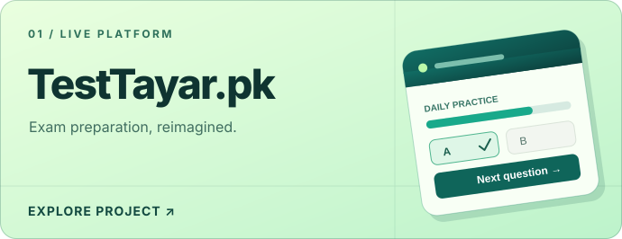
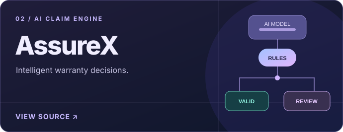

  

<b>I turn ideas into products people can actually use.</b> Independent developer working across web, cloud &amp; applied AI.

<table>
  <tr>
    <td width="50%"></td>
    <td width="50%"></td>
  </tr>
</table>

  <a href="https://samidev.pk">Portfolio</a> &nbsp; · &nbsp;
  <a href="https://github.com/sami2515?tab=repositories">Repositories</a> &nbsp; · &nbsp;
  <a href="https://testtayar.pk">Live product</a>

